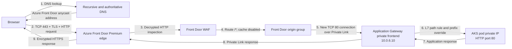

# Azure Application Request Flow

This guide explains how a browser request travels through the Azure platform in this repository until it reaches a Solar System or Starship Fleet container in AKS, and how the response returns to the browser.

It describes the deployed configuration, not an idealized future design. The current public URLs are:

- `https://central-dev-sks-edge-d2d5e2czccfddja7.z03.azurefd.net/solar/`
- `https://central-dev-sks-edge-d2d5e2czccfddja7.z03.azurefd.net/starfleet/`

The related architecture image is [azure-platform-hld.png](azure-platform-hld.png).

## 1. Request path at a glance



The most important concept is that this is not one continuous client connection. There are separate connection segments:

| Segment | Connection | Current protocol | Encryption |
|---|---|---|---|
| Browser to Front Door edge | Client TCP connection | HTTPS on TCP 443 | TLS |
| Front Door to Application Gateway | Separate origin TCP connection over Private Link | HTTP on TCP 80 | No TLS; private Microsoft backbone path |
| Application Gateway to AKS pod | Separate backend TCP connection inside the VNet | HTTP on TCP 80 | No TLS; private VNet path |

TLS currently terminates at Azure Front Door. Application Gateway performs Layer 7 HTTP routing, but it does **not** terminate TLS in the present configuration. End-to-end TLS is a future hardening step.

## 2. What each layer is responsible for

| Layer | Main responsibility in this platform | What it does not do here |
|---|---|---|
| DNS | Translates the Front Door hostname into reachable Front Door addresses | It does not inspect HTTP, select an AKS pod, or enforce WAF rules |
| Azure Front Door | Global public entry point, TLS termination, edge WAF, HTTP redirect, global route selection, origin health monitoring, and private origin connectivity | Caching is not enabled in the current route |
| Front Door WAF | Inspects the decrypted HTTP request for web attacks and bots and blocks matches at the edge | It is not a general TCP/UDP network firewall |
| Private Link | Provides a private Front Door-to-Application Gateway data path over Microsoft's backbone | It does not inspect application content or replace WAF rules |
| Application Gateway | Regional Layer 7 reverse proxy, path routing, path override, pod health probes, and backend selection | The deployed `Standard_v2` SKU is not a WAF SKU, and its active listener is HTTP rather than HTTPS |
| AGIC | Watches Kubernetes resources and programs Application Gateway configuration | It is a control-plane component; application requests do not pass through the AGIC pod |
| Kubernetes Service/EndpointSlice | Defines which pods belong to each application backend | The request does not traverse the Service ClusterIP in the AGIC data path |
| AKS pod | Runs the application process that handles the HTTP request | It is not publicly addressed and does not perform global edge security |

## 3. Detailed request lifecycle

The following example uses:

```text
GET https://central-dev-sks-edge-d2d5e2czccfddja7.z03.azurefd.net/solar/3
```

### Step 1: The browser prepares the request

The browser parses the URL into:

- Scheme: `https`
- Host: `central-dev-sks-edge-d2d5e2czccfddja7.z03.azurefd.net`
- Port: implicit TCP 443
- Path: `/solar/3`
- HTTP method: `GET`

Before it can open a connection, it needs an IP address for the hostname. The browser first checks its own DNS and connection caches. The operating system may also have a cached result.

### Step 2: DNS resolution finds Azure Front Door

If the answer is not cached, the client asks its configured recursive DNS resolver. The resolver follows the DNS delegation chain and obtains the records for the Azure-provided `azurefd.net` endpoint.

The returned addresses represent Azure Front Door's global edge. Azure Front Door uses anycast routing so the same service addresses can be advertised from many Microsoft edge locations. Internet routing normally carries the client to a nearby healthy Front Door point of presence (PoP).

There is no customer-managed DNS zone in this request path yet. When a custom domain is added later, its public DNS record will normally point to the Front Door endpoint, and Front Door will present a certificate for that custom hostname.

DNS is only service discovery at this stage. It does not send the browser directly to Application Gateway or AKS.

### Step 3: The browser establishes TCP and TLS with Front Door

The browser opens a TCP connection to the selected Front Door edge address on port 443. The TCP handshake establishes the reliable byte stream.

The browser and Front Door then perform a TLS handshake:

1. The browser sends a TLS ClientHello, including the Front Door hostname through SNI and its supported TLS parameters.
2. Front Door returns the certificate for the Azure-provided endpoint and negotiates TLS settings.
3. The browser validates the certificate chain, hostname, validity period, and trust.
4. Both parties derive session keys.
5. HTTP traffic between the browser and Front Door is now encrypted and integrity protected.

Front Door terminates the client TCP and TLS sessions at the edge. It can therefore read the HTTP request after decryption and apply HTTP-aware controls. It does not simply pass the original TLS stream through to Application Gateway.

If a client starts with plain HTTP, the configured Front Door route accepts it only to return an HTTPS redirect. The application request is then retried by the browser over HTTPS.

### Step 4: Front Door WAF inspects the request

The WAF security policy is associated with the Front Door default domain and pattern `/*`, so it applies to both `/solar/*` and `/starfleet/*`.

The current policy is enabled in `Prevention` mode and uses:

- Microsoft Default Rule Set `2.1`
- Microsoft Bot Manager Rule Set `1.1`
- `Block` as the configured managed-rule action

WAF evaluates HTTP-layer properties such as the URI, query string, headers, cookies, method, and request body where applicable. The managed rules are designed to detect classes of attacks such as SQL injection, cross-site scripting, local file inclusion, protocol anomalies, and malicious bot behavior.

Two outcomes are possible:

- **Blocked:** Front Door returns a WAF response, normally HTTP `403`, at the edge. Application Gateway, AKS, and the pod never see the request.
- **Allowed:** Processing continues to Front Door route matching.

This is an application-layer firewall decision. It is different from a subnet NSG, which reasons mainly about source/destination addresses, ports, and protocols rather than HTTP content.

The current Terraform does not define custom WAF IP allow/deny rules, geo-filtering, or rate-limit rules. Only the two managed rule sets are configured.

### Step 5: Front Door matches the route

The Front Door route currently has these relevant settings:

- Endpoint: the Azure-provided `azurefd.net` hostname
- Supported client protocols: HTTP and HTTPS
- HTTP-to-HTTPS redirect: enabled
- Path pattern: `/*`
- Origin group: the Application Gateway origin group
- Origin forwarding protocol: `HttpOnly`
- Caching: not configured, and therefore disabled

Because `/*` matches the whole site, both application prefixes use the same Front Door route and origin group. Front Door does not currently rewrite `/solar/...` or `/starfleet/...`; that decision is made later by Application Gateway.

Caching being disabled means every accepted application request is sent to the origin. Front Door still supplies edge TLS termination, WAF, global entry, connection acceleration, routing, and health monitoring, but it does not serve the application files from a CDN cache in this configuration.

### Step 6: Front Door checks origin health state

Origin health is maintained outside the individual user request. Front Door sends a health probe with these settings:

- Protocol: HTTP
- Method: `GET`
- Path: `/solar/live`
- Interval: 30 seconds
- Sample size: 4
- Successful samples required: 3

The user request is routed only to an origin that Front Door considers healthy. There is currently one origin, so this health state is a gate rather than a choice among multiple regional origins. If the only origin is unhealthy, Front Door cannot fail over to a second region and returns a Front Door error instead.

Front Door health probes use the same Private Link route as normal origin traffic.

### Step 7: Front Door creates an origin connection through Private Link

Front Door does not forward the browser's original TCP connection. It uses a separate connection from Microsoft's Front Door infrastructure to the Application Gateway origin.

The deployed Front Door Premium origin has an approved shared Private Link connection to the Application Gateway frontend configuration named `private-frontend`. The path is conceptually:

```text
Front Door PoP
  -> Front Door regional cluster and Microsoft-managed VNet
  -> Front Door-managed private endpoint
  -> Azure Private Link platform
  -> Application Gateway Private Link configuration
  -> Application Gateway private frontend 10.0.6.10
```

This origin traffic stays on Microsoft's backbone and does not enter Application Gateway through the public internet.

The origin connection currently uses HTTP on TCP port 80 because `forwarding_protocol = "HttpOnly"`. The `Host` header sent to the origin is currently `10.0.6.10`.

Private Link supplies network isolation, but it does not itself encrypt the HTTP payload. Private and encrypted are separate properties:

- **Private:** yes, because Front Door reaches the origin through Private Link.
- **TLS encrypted:** no, on this segment in the current configuration.

### Step 8: Application Gateway accepts the private request

Application Gateway listens on its private frontend IP `10.0.6.10`. AGIC creates and maintains the effective listeners, routing rules, backend pools, HTTP settings, and probes needed by the Kubernetes Ingress.

Application Gateway is a Layer 7 reverse proxy. It terminates the Front Door-to-gateway TCP connection and parses the HTTP request. It can then make a routing decision using HTTP properties, particularly the request path.

The deployed gateway is `Standard_v2`, not `WAF_v2`. Therefore:

- It performs Layer 7 routing and health-based backend selection.
- It does not provide a second Application Gateway WAF inspection layer.
- Its active application path currently uses an HTTP listener on port 80.
- The Terraform-created public frontend is retained, but the application Ingress explicitly requests the private frontend. The intended data path is through Front Door and Private Link.

No explicit network security groups are defined for these subnets by the current VNet module. The principal origin isolation control is the private frontend plus Front Door Private Link path, rather than a custom NSG policy.

### Step 9: Application Gateway selects the application by URL path

The Kubernetes Ingress defines two path rules:

| Incoming path | Kubernetes backend service |
|---|---|
| `/solar/*` | `solar-system-service:80` |
| `/starfleet/*` | `starship-fleet-service:80` |

For the example `/solar/3`, Application Gateway selects the Solar System backend.

The Ingress also sets:

```yaml
appgw.ingress.kubernetes.io/backend-path-prefix: "/"
```

AGIC translates this into an Application Gateway backend path override. It allows the externally visible service prefix to be replaced with the application's root-path form before the request reaches the pod. This is why the applications can be exposed below `/solar/` and `/starfleet/` without needing to be authored with those external prefixes as their internal base paths.

The annotation applies to the whole Ingress resource, so it applies to both service paths.

### Step 10: Application Gateway checks pod health

AGIC configures custom Application Gateway backend probes from the Ingress annotations:

- Protocol: HTTP
- Path: `/live`
- Healthy status range: `200-399`
- Interval: 30 seconds
- Timeout: 5 seconds
- Unhealthy threshold: 3 consecutive failed probes

Application Gateway continuously probes the backend pods. It sends a user request only to a pod endpoint that it currently considers healthy. If all endpoints for a selected service are unhealthy, Application Gateway normally returns `502 Bad Gateway`.

The configured backend request timeout is 30 seconds. If a pod does not return a response within that time, the gateway can terminate the backend attempt and return a gateway error.

Front Door and Application Gateway therefore perform different health checks:

- Front Door checks whether the origin path through Application Gateway is usable.
- Application Gateway checks whether the individual application pod backends are usable.

### Step 11: AGIC supplies configuration, not application traffic

The Application Gateway Ingress Controller runs as a pod in AKS and watches Kubernetes resources including `Ingress`, `Service`, and endpoint information.

Its control loop is:

```text
Kubernetes desired state changes
  -> AGIC observes the change
  -> AGIC translates it into Application Gateway configuration
  -> AGIC updates Application Gateway through Azure Resource Manager
```

AGIC uses its managed identity and Azure role assignments to update Application Gateway. It does not sit inline as a reverse proxy, and user traffic does not flow through the `ingress-appgw` pod.

This distinction matters during troubleshooting:

- An AGIC permission or reconciliation problem prevents correct gateway configuration.
- Once the gateway is correctly configured, the data path is Application Gateway directly to pod IPs, even though AGIC remains running as the controller.

### Step 12: Application Gateway connects directly to a pod IP

The AKS cluster uses Azure CNI networking. Pods receive private addresses reachable through Azure virtual networking.

AGIC puts the healthy pod endpoint IPs into Application Gateway backend pools. Application Gateway opens a new HTTP connection directly to a selected pod private IP on the service target port.

This design deliberately avoids extra data-plane hops:

- No Kubernetes public load balancer
- No `NodePort`
- No `kube-proxy` forwarding hop
- No request through the Kubernetes Service ClusterIP
- No request through the AGIC pod

The Kubernetes Service is still important. Its selector identifies the eligible application pods, and Kubernetes EndpointSlices record the matching endpoints. AGIC uses that desired state to build the gateway backend pool. The Service is therefore part of service discovery and configuration even though its ClusterIP is not in the packet path.

### Step 13: The application container handles the request

The packet reaches the network namespace of the chosen pod running on an AKS node VM. The application process listening in that container receives the rewritten HTTP request.

At this point normal application behavior begins. The application may:

- Validate the method, path, headers, and input.
- Read configuration or a Kubernetes Secret.
- Connect separately to PostgreSQL using its private endpoint and private DNS.
- Produce an HTML, JSON, image, or error response.

The PostgreSQL call, if made, is a separate east-west connection. It is not another hop in the original browser TCP connection.

## 4. Response path

The response returns through the proxies in reverse order, but each proxy owns its own connection segment:

1. The pod sends an HTTP response to Application Gateway.
2. Application Gateway sends the origin response to Front Door through the established private origin path.
3. Front Door can add or preserve platform headers and records request metrics/log data where diagnostics are enabled.
4. Because caching is disabled, Front Door does not store the response for a later request.
5. Front Door encrypts the response on the client TLS session and sends it to the browser.
6. The browser decrypts the TLS records, processes the HTTP response, and renders the content.
7. Additional page assets trigger more HTTP requests through the same logical path. Existing TCP/TLS connections may be reused when protocol and connection state allow it.

The application's view of the immediate network peer is a proxy, not the original browser. Proxy-added forwarding headers are therefore important when the application needs the original host, scheme, or client address. Applications should trust such headers only from known proxy paths.

## 5. Security controls by layer

### Internet and edge

- Azure Front Door is the only intended public application entry point.
- HTTPS protects the browser-to-edge connection.
- The Azure-managed certificate protects the current `azurefd.net` hostname.
- The Front Door WAF blocks matching managed-rule and bot threats in Prevention mode.
- Azure's global edge and platform provide large-scale network resilience, but WAF remains an HTTP security control rather than a replacement for all DDoS and network architecture planning.

### Origin isolation

- Front Door Premium reaches Application Gateway through an approved Private Link connection.
- The origin is not addressed over the public internet in the intended application flow.
- Application Gateway exposes a private listener for the AGIC Ingress.
- The current public frontend resource is labeled unused and is not the frontend selected by this Ingress.

### Regional application routing

- Application Gateway performs path-based Layer 7 routing.
- Health probes keep failed pod endpoints out of the active backend set.
- The 30-second backend timeout limits how long a request can occupy a gateway backend attempt.
- `Standard_v2` means there is no Application Gateway WAF policy in this deployment.

### Workload isolation

- Pods use private VNet-reachable addresses and have no direct public endpoint.
- AKS node egress uses the configured NAT Gateway.
- ACR and PostgreSQL use private endpoints for their relevant private data paths.
- AKS API authorization, Microsoft Entra integration, Azure RBAC, and `kubelogin` protect cluster administration; they are not part of an end-user HTTP request to an application pod.

## 6. Rules that are checked for a `/solar/3` request

| Order | Component | Check or decision | Failure result |
|---:|---|---|---|
| 1 | Browser/DNS | Can the Front Door hostname be resolved? | DNS/browser error |
| 2 | Browser/Front Door | Can TCP 443 and the TLS handshake complete? | Connection or certificate error |
| 3 | Front Door route | If HTTP was used, redirect to HTTPS | HTTP redirect |
| 4 | Front Door WAF | Do managed web-attack or bot rules block the request? | Usually HTTP 403 at the edge |
| 5 | Front Door route | Does domain/protocol/path match `/*`? | Front Door route error/404 |
| 6 | Front Door origin health | Is the single Application Gateway origin healthy? | Front Door 5xx |
| 7 | Private Link | Is the approved private endpoint connection usable? | Front Door origin connection failure/5xx |
| 8 | Application Gateway listener | Is there a private listener accepting HTTP for this request? | Gateway routing/listener failure |
| 9 | Application Gateway path map | Does `/solar/*` match a configured rule? | Default/no-match behavior or 404 |
| 10 | Application Gateway backend health | Is at least one Solar System pod healthy on `/live`? | Usually HTTP 502 |
| 11 | Pod application | Does the application accept and successfully process the rewritten request? | Application-defined 4xx/5xx |

## 7. Control plane versus data plane

Several platform components configure the route but do not carry each user request.

### Data plane

The runtime request data path is:

```text
Browser -> Front Door/WAF -> Private Link -> Application Gateway -> AKS pod
```

### Control plane

The components that establish or update that path include:

- Terraform and Azure Resource Manager, which create Front Door, WAF, Private Link, Application Gateway, VNet, and AKS resources.
- Kubernetes API, where the Ingress, Services, EndpointSlices, Deployments, and Pods are declared.
- AGIC, which converts Kubernetes desired state into Application Gateway configuration.
- Azure health-probe systems, which update backend health state.
- DNS control planes, which publish the Front Door endpoint records.

This explains why an AGIC or Terraform problem can affect future configuration changes while already established data-plane resources might continue serving traffic.

## 8. Current implementation versus the stronger target state

| Capability | Current state | Stronger production target |
|---|---|---|
| Public hostname | Azure-provided `azurefd.net` name | Custom domain with controlled public DNS |
| Browser TLS | Terminates at Front Door | Retain Front Door TLS with an explicit current TLS policy |
| Front Door to App Gateway | HTTP over Private Link | HTTPS over Private Link with certificate name validation |
| App Gateway to pods | HTTP | HTTPS if workload risk justifies backend TLS |
| Edge WAF | Front Door Premium WAF, Prevention, DRS 2.1 and Bot 1.1 | Tune exclusions, consider latest tested DRS, add rate limits and other custom rules |
| Regional WAF | None; App Gateway is `Standard_v2` | Use `WAF_v2` only if a justified second inspection layer is required |
| CDN cache | Disabled | Add separate cache-enabled routes/rules only for safe static content |
| Origin redundancy | One App Gateway origin in one region | Multiple healthy regional origins for failover |
| Subnet filtering | No explicit NSGs in the current VNet module | Add least-privilege NSGs where compatible with Azure service requirements |
| Edge/gateway diagnostics | No Front Door or App Gateway diagnostic settings in current Terraform | Send Front Door access/WAF logs and App Gateway access/performance/firewall logs to Log Analytics |

Private Link significantly reduces origin exposure, but it is not a substitute for end-to-end TLS when policy requires encryption on every segment.

## 9. Troubleshooting by symptom

### DNS or browser name error

Check DNS resolution and whether the Front Door endpoint is enabled. With a future custom domain, also verify the CNAME, domain validation record, and certificate state.

### TLS or certificate warning

The failure is on the browser-to-Front Door segment. Confirm the hostname matches the certificate and that the client clock and trust store are valid.

### HTTP 403 from Front Door

Inspect WAF logs and the matched managed-rule ID. A legitimate request may require rule tuning or a narrow exclusion; disabling the full managed rule set should not be the first response.

### Front Door 502/503

Check:

1. Front Door origin health for `/solar/live`.
2. Private endpoint connection approval and provisioning state.
3. Application Gateway private listener and frontend association.
4. Whether Application Gateway can reach healthy pods.

### Application Gateway 502

Check:

```bash
kubectl get ingress -n dev
kubectl describe ingress shared-private-ingress -n dev
kubectl get services,endpointslices,pods -n dev -o wide
kubectl logs -n kube-system deployment/ingress-appgw-deployment
```

Then inspect Application Gateway backend health. Common causes are an incorrect probe path, no matching Service endpoints, a port mismatch, pod readiness failure, or an application timeout.

### Application 404

If Front Door and gateway health are good, inspect the path rule and backend path override. Compare the external path with the path the application actually receives.

## 10. Repository configuration that implements this flow

- [Front Door profile, route, WAF, probes, and Private Link origin](../terraform/azure/modules/front-door/main.tf)
- [Application Gateway private frontend, Private Link configuration, and bootstrap listener](../terraform/azure/modules/application-gateway/main.tf)
- [AGIC Ingress paths, backend prefix, timeout, and probe annotations](../kubernetes/dev/agic-ingress.yaml)
- [Dev environment wiring and AGIC role assignments](../terraform/azure/envs/dev/main.tf)
- [VNet and dedicated subnets](../terraform/azure/modules/vnet/main.tf)
- [AKS Azure CNI network profile and AGIC add-on](../terraform/azure/modules/aks/main.tf)

## 11. Microsoft references

- [Azure Front Door traffic acceleration and anycast](https://learn.microsoft.com/en-gb/azure/frontdoor/front-door-traffic-acceleration)
- [Azure Front Door TLS encryption](https://learn.microsoft.com/en-us/azure/frontdoor/end-to-end-tls)
- [Azure Front Door route matching](https://learn.microsoft.com/en-us/azure/frontdoor/front-door-route-matching)
- [Azure Front Door caching configuration](https://learn.microsoft.com/en-us/azure/frontdoor/how-to-configure-caching)
- [Web Application Firewall on Azure Front Door](https://learn.microsoft.com/en-us/azure/frontdoor/web-application-firewall)
- [Azure Front Door WAF policy modes](https://learn.microsoft.com/en-us/azure/web-application-firewall/afds/waf-front-door-policy-settings)
- [Secure an Azure Front Door origin with Private Link](https://learn.microsoft.com/en-us/azure/frontdoor/private-link)
- [Connect Front Door to Application Gateway through Private Link](https://learn.microsoft.com/en-us/azure/frontdoor/how-to-enable-private-link-application-gateway)
- [Application Gateway Ingress Controller overview](https://learn.microsoft.com/en-us/azure/application-gateway/ingress-controller-overview)
- [AGIC annotations](https://learn.microsoft.com/en-us/azure/application-gateway/ingress-controller-annotations)
- [Application Gateway health probes](https://learn.microsoft.com/en-us/azure/application-gateway/application-gateway-probe-overview)

